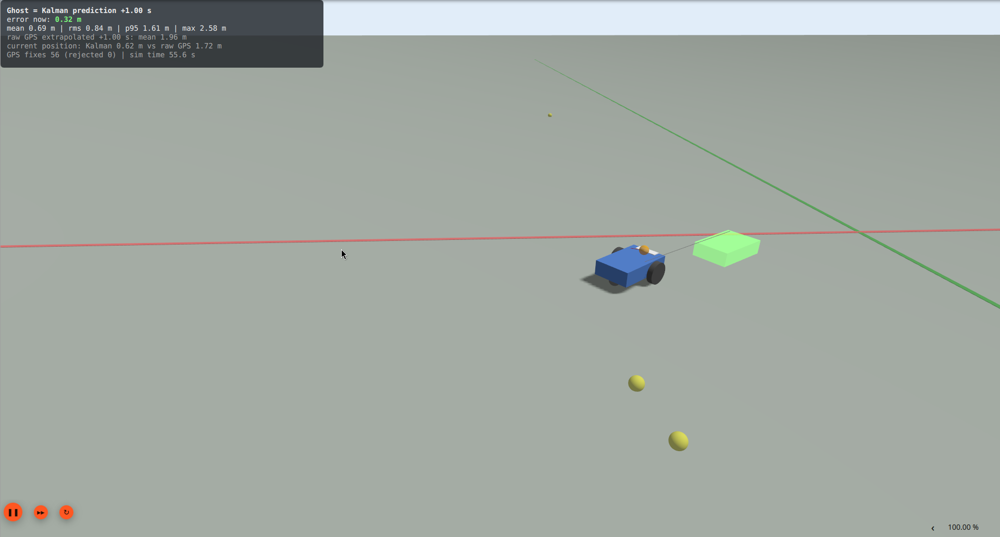
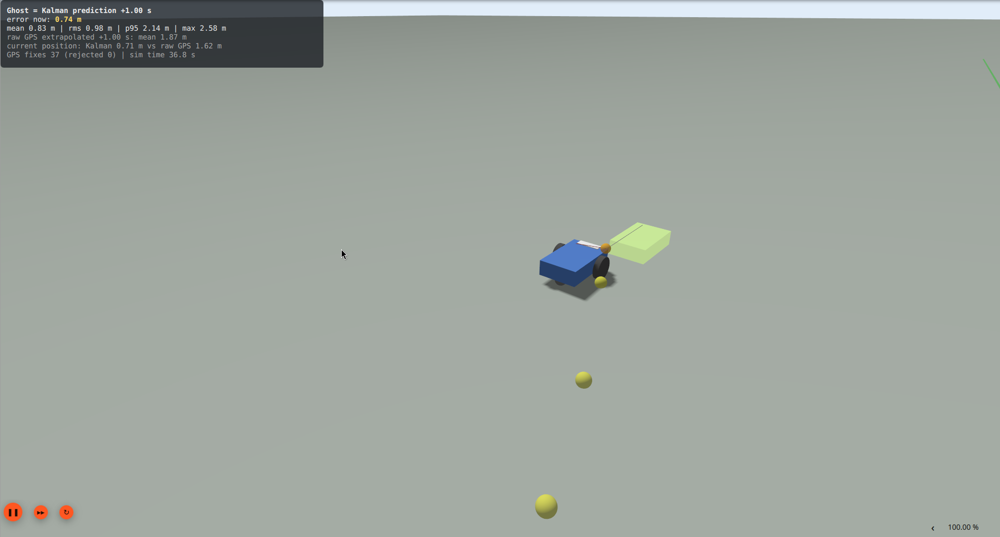

# gnss-imu-fusion

position estimation and short term position prediction for a raspberry pi 4
carrying a u-blox max-m10s gnss receiver and an xsens mti-630 imu. gps fixes
(1 hz) and imu acceleration (100 hz) are fused in a kalman filter, which
gives a smoother position than the raw receiver and predicts where the device
will be a moment later.



## how it works

```
max-m10s ── nmea (9600 baud) ──▶ rmc/gga parser ──▶ utm ──┐
                                                          ├──▶ queue ──▶ kalman filter ──▶ estimate + prediction
mti-630 ─── xbus (115200 baud) ─▶ mtdata2 parser ─────────┘
```

- **gps**: `$..rmc` sentences give position, speed and course; `$..gga`
  gives the hdop, which sets how much each fix is trusted. sentences are
  checksum verified and converted to utm metres.
- **imu**: mtdata2 packets give the orientation quaternion and the
  acceleration (or the gravity free acceleration if enabled), rotated into
  the local east/north frame.
- **filter**: state is `[east, north, v_east, v_north]`. every imu sample
  predicts the state forward with the measured acceleration, every gps fix
  corrects it. fixes that disagree too much with the prediction are rejected
  (chi-square gate), and the filter restarts from gps if that keeps
  happening. without an imu it runs on gps alone.
- **prediction**: `position_estimator::predict_ahead(t)` extrapolates the
  current estimate `t` seconds ahead with the current acceleration.

## layout

| path | what |
|---|---|
| `includes/`, `src/` | the libraries: `time_and_location`, `rmc`, `utm`, `xbus`/`mti_630`, `gps`, `kalman` |
| `src/main.cpp` | the device program, prints the estimate as csv |
| `sim/` | gazebo simulation: world, bridge program, gui overlay plugin |
| `test/cpp/` | unit tests |
| `test/python/` | serial capture script and a recorded nmea log |
| `docs/` | datasheets and papers used |

## building

needs cmake ≥ 3.22 and a c++20 compiler. boost (asio, headers only) is only
needed for the device program; without it the libraries and tests still
build.

```
mkdir build && cd build
cmake ..
cmake --build .
ctest
```

## running on the device

```
./build/src/main                                   # live: gps on uart0, imu on uart4
./build/src/main test/python/get_data/data.txt     # replay a recorded nmea log
```

output is csv on stdout: the estimate (lat/lon and utm), velocity,
uncertainty, the raw gps fix and the position predicted one second ahead.
if the imu port cannot be opened it runs on gps only. `docs/uart.sh` has the
notes for enabling the uarts on the pi.

for the best imu input, enable the free acceleration output in mt manager
and set the magnetic declination, otherwise north is magnetic north.

## simulation

a two wheeled vehicle drives a figure-eight in gazebo harmonic while its
speed swings between 1 and 4 m/s. it carries a 100 hz imu and a 1 hz gps
with 1.5 m of noise. `positioning_sim` feeds them to the same
`position_estimator` the device uses, draws the prediction as a green
"ghost" in front of the vehicle, and scores every prediction against the
true pose once the simulation reaches that moment.

```
distrobox enter gazebo -- sim/run.sh                                  # with the gazebo window
distrobox enter gazebo -- sim/run.sh --headless --duration 120        # terminal only
distrobox enter gazebo -- sim/run.sh --horizon 0.5 --gps-noise 3 --gps-drift 2
```

`run.sh` builds into `build-sim/`, starts gazebo and runs the bridge; ctrl-c
prints the summary. on fedora gazebo lives in the `gazebo` distrobox (ubuntu
24.04 with `gz-harmonic` from packages.osrfoundation.org). options:

| option | default | |
|---|---|---|
| `--horizon s` | 1.0 | how far ahead the ghost predicts (0.01 = next imu sample) |
| `--gps-noise m` | 1.5 | white gps position noise |
| `--gps-drift m` | 0 | slowly wandering gps error, like multipath |
| `--duration s` | forever | stop after this much simulated time |
| `--radius m` | 12 | figure-eight loop radius |
| `--manual` | | don't drive; add the teleop gui plugin and drive by hand |
| `--no-follow` | | don't move the camera with the vehicle |



what is drawn:

- **green box**: the predicted pose, turning yellow then red as the latest
  prediction error grows
- **orange sphere and red line**: where an earlier ghost said the vehicle
  would be now, and how far off it was
- **yellow dots**: the last 20 noisy gps fixes
- **top left overlay**: live accuracy, from the accuracy overlay gui plugin
  in `sim/gui_plugin/`

### results

120 simulated seconds, 1.5 m gps noise, 1 s horizon (metres):

| | mean | p95 |
|---|---|---|
| ghost (kalman prediction, 1 s ahead) | 0.69 | 1.29 |
| raw gps fix extrapolated 1 s with its own velocity | 2.09 | 3.96 |
| kalman estimate of the current position | 0.60 | 1.04 |
| raw gps fix | 1.88 | 3.50 |

at short horizons the prediction error equals the current position error
(0.61 m at 10 ms), so what limits it there is the gps noise, not the
prediction.
